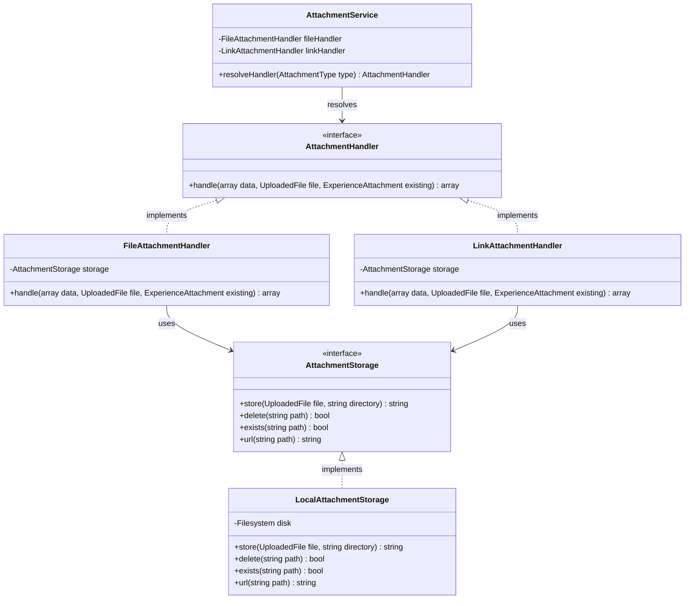

# Arsitektur Aplikasi Portofolio & Prinsip OOP

Dokumen ini menjelaskan struktur arsitektur berorientasi objek (OOP), pola desain (Design Patterns), dan pemisahan tanggung jawab (Separation of Concerns) yang diterapkan pada website portofolio profesional.

---

## 1. Prinsip Utama (SOLID & Clean Code)

1. **Single Responsibility Principle (SRP)**:
   - Model hanya menangani relasi, casts, query scopes, dan accessor.
   - Controller sangat tipis (thin controllers), hanya bertindak sebagai mediator antara HTTP request dan domain use-case.
   - Use-case bisnis dibungkus dalam **Action** tunggal (`CreateMessage`, `TrackPageView`, `PublishProject`, `ReplaceExperienceAttachment`).
2. **Open / Closed Principle (OCP)** & **Polymorphism**:
   - Pola **Strategy** digunakan untuk menangani jenis lampiran (`AttachmentType::File` dan `AttachmentType::Link`) melalui antarmuka `AttachmentHandler`. Penambahan tipe lampiran baru di masa depan tidak perlu mengubah kode pemanggil.
3. **Liskov Substitution Principle (LSP)**:
   - Implementasi storage abstraksi `AttachmentStorage` (`LocalAttachmentStorage`) dapat diganti (misal ke `S3AttachmentStorage`) tanpa merusak logika aplikasi.
4. **Interface Segregation Principle (ISP)**:
   - Kontrak didefinisikan secara spesifik di direktori `app/Contracts`.
5. **Dependency Inversion Principle (DIP)**:
   - Dependensi disuntikkan melalui *Constructor Injection*. Tidak ada pembuatan instance dengan `new` secara langsung di kelas domain atau service.

---

## 2. Diagram Kelas Pola Strategy (Attachment Handling)



---

## 3. Struktur Direktori OOP

```
app/
├── Actions/                 # Single-purpose Action classes
│   ├── CreateMessage.php
│   ├── PublishProject.php
│   ├── ReplaceExperienceAttachment.php
│   └── TrackPageView.php
├── Contracts/               # Abstraksi dan antarmuka
│   ├── AttachmentHandler.php
│   └── AttachmentStorage.php
├── Data/                    # Readonly Data Transfer Objects (DTO)
│   ├── MessageData.php
│   └── PageViewData.php
├── Enums/                   # PHP 8.3 Backed Enums (No magic strings)
│   ├── AttachmentType.php
│   ├── ExperienceType.php
│   ├── MediaType.php
│   ├── MessageStatus.php
│   ├── ProjectStatus.php
│   ├── SkillType.php
│   └── UserRole.php
├── Exceptions/              # Domain-specific exceptions
│   └── InvalidAttachmentException.php
├── Filament/                # Panel Admin (Resources, Pages, Widgets)
├── Http/
│   ├── Controllers/         # Thin Controllers
│   ├── Middleware/          # Anonymous visitor hashing & tracking
│   ├── Requests/            # FormRequests with honeypot validation
│   └── Resources/           # API JSON Resources & Collections
├── Models/                  # Thin Eloquent models
├── Observers/               # Automated filesystem cleanup observers
│   ├── ExperienceAttachmentObserver.php
│   ├── ExperienceObserver.php
│   └── ProjectObserver.php
├── Policies/                # Authorization policies (Admin vs Editor)
└── Services/                # Cross-cutting services
    ├── AttachmentService.php
    ├── FileAttachmentHandler.php
    ├── LinkAttachmentHandler.php
    ├── LocalAttachmentStorage.php
    └── VisitorHasher.php
```

---

## 4. Alur Pembersihan Storage Otomatis (Model Observer)

Ketika data Proyek atau Pengalaman dihapus:
1. `ProjectObserver` / `ExperienceObserver` mendeteksi event `deleting`.
2. Observer memanggil `AttachmentStorage::delete()` untuk menghapus thumbnail, berkas lampiran, dan media terkait dari disk storage publik.
3. Database cascading menghapus record relasi pivot, highlights, dan media polimorfik.
